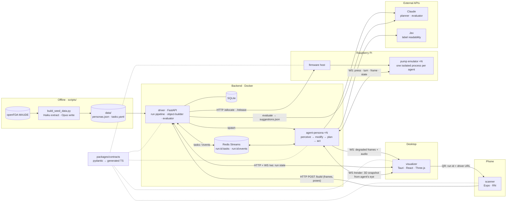

# Infallible

Thousands of FDA MAUDE reports trace insulin-pump harm to use errors: a misread decimal, a missed alarm, a button pressed by a shaky hand. Infallible scans a pump, emulates its firmware, and lets Claude-driven personas with simulated vision, hearing, and motor impairments run MAUDE-derived tasks on it, then proposes design fixes from where they fail.

